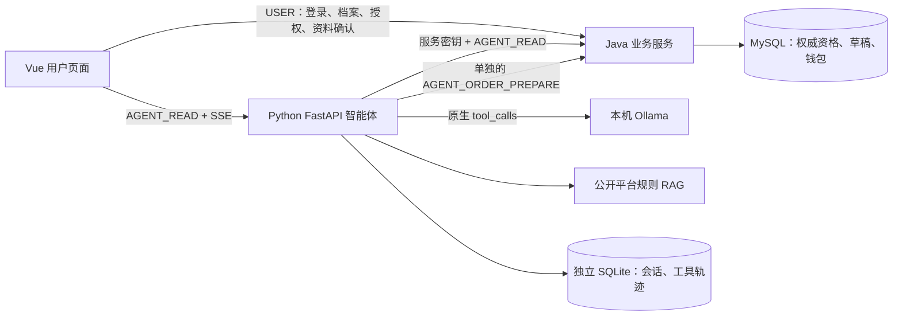
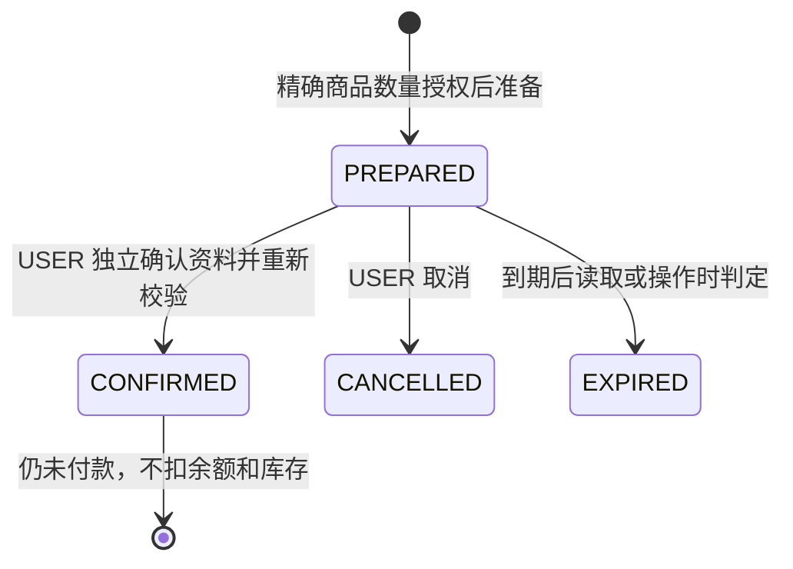

# M4.3 隔离演示与恢复手册

## 环境

| 项目 | 原业务环境 | 虚构演示环境 |
| --- | --- | --- |
| Vue | 127.0.0.1:3000 | 127.0.0.1:13000，页头显示“虚构演示” |
| Java | 127.0.0.1:8080 | 127.0.0.1:18080 |
| FastAPI | 127.0.0.1:8000 | 127.0.0.1:18000 |
| MySQL | 原 .env.local 指定库 | DeepseekDoc_M43_Demo |
| 数据库登录 | 原配置 | 自动生成的 ddm43_ 独立账号，仅授权演示库 |
| 服务密钥 | 原配置 | 单独随机生成 |
| 会话、RAG、日志 | .local-run | .local-demo |
| 私密配置 | .env.local | .env.demo.local |

两个环境共用已有本机 Ollama 模型权重，不共用会话或知识索引。
演示商品全部是虚构名称，模拟审核来源为 local://synthetic-tests/m43。
正常环境中的布洛芬、枇杷露不会被演示初始化器设为已审核。

## 启动与测试

在项目根目录使用 PowerShell。前置：MySQL 和 Ollama 已启动，Java 已完成构建，
前端 node_modules 已安装；本机已有工具模型别名和 bge-m3。
初始化需要原数据库登录具有创建数据库、创建演示数据库账号和授权的权限。
凭证仅从私密配置读取，不放进命令行；前端进程不继承数据库凭证或服务密钥。

```powershell
python -u -X utf8 scripts/demo.py initialize
python -u -X utf8 scripts/demo.py knowledge
python -u -X utf8 scripts/demo.py start
python -u -X utf8 scripts/m43_validate.py
python -u -X utf8 scripts/m43_browser_fixtures.py
```

initialize 可重复调用，已有标记的演示库不会被覆盖。start 遇到端口占用直接拒绝，
不会杀死占用端口的陌生进程。演示页面使用独立端口隔离浏览器登录存储。
合成浏览器账号保存在 .local-demo/browser-account.json，只在本机查看，不提交、不公开。

m43_validate.py 顺序执行认证钱包/会话、健康资料撤回/RAG、只读工具、草稿状态机和
三轮固定模型评测。最终报告为 .local-demo/m43-regression.json；日志位于其 logs 子目录。
真实模型评测不等同于协议模拟测试；两者证据分别保留。

浏览器控件验收使用 scripts/m43-browser.cua.mjs，**依赖 Codex 的 CUA 浏览器运行时**，
不是普通 Node 或 Python 命令，也没有声称已接入无头浏览器 CI。
在 CUA 连接好浏览器并读取文档后，以一次调用重复运行：

```javascript
const fs = await import("node:fs/promises");
const root = "D:/WebProject/三组-龙玺林-实训资料/东方标准实训第三组/DeepseekDoc家庭智慧问询";
const suite = await import(`file:///${root}/scripts/m43-browser.cua.mjs`);
await suite.run({ cua, browser, fs, root });
```

脚本只操作 13000 端口和合成账号，逐步骤保存报告/失败截图，最后恢复浏览器默认尺寸。
运行前的m43_browser_fixtures.py使用真实Java准备接口建立合成异常草稿，
只在演示库模拟调价、缺货、审核版本变化、过期，并准备第二个合成账号。
每次运行主动发起新的合成购买需求，会留下新的未付款演示草稿；幂等重放属于同一请求键，
不能把再次主动授权的新需求与网络重试混为一谈。

## 中断恢复与清理

```powershell
python -u -X utf8 scripts/m43_cleanup.py
python -u -X utf8 scripts/demo.py stop
```

联调注册成功后，将账号名、数据库用户 UUID、商品 ID 和目标指纹原子写入
.local-demo/fixtures；不记录密码、支付密码、代理凭证、健康档案或收货资料。
异常结束后，cleanup 只读取这些成功创建记录，核验数据库指纹和账号 UUID；
发现同名账号被替换时拒绝删除。正常 finally 清理成功后删除对应记录。
如果在数据库提交与本地记录落盘的极短窗口中进程被强制终止，可能留下无记录数据；
此时不根据 it_ 名称前缀猜测删除，可重建整个有标记的演示库。

需要恢复全新演示数据时：

```powershell
python -u -X utf8 scripts/demo.py reset
python -u -X utf8 scripts/demo.py initialize
python -u -X utf8 scripts/demo.py knowledge
python -u -X utf8 scripts/demo.py start
```

reset 先校验固定库名、与正常配置不同以及库内所有权标记，再停止托管演示进程，
仅删除该演示库、对应随机数据库账号、演示配置及明确列出的 SQLite 文件。
不递归删除目录，备份与证据保留。标记缺失、目标被改成业务库时拒绝执行。
初始化在部分迁移失败后不会盲目接管或清空其他库，应先检查日志/备份，再使用此流程。

## 业务架构与权限



AI 无 USER 凭证、收货资料和支付权限。公开 RAG 不导入个人档案；健康上下文仍需单独同意，
撤回会终止相关生成。商品销售资格和金额由 Java 决定，LLM 无法改写审核结果。



撤销代理授权不删除已保存草稿；不确定写结果应使用固定 requestKey 到“我的草稿”恢复查询，
禁止自动换新授权重写。支付状态机、支付授权、第三方沙箱仍属于后续 M5。

## 毕设演示顺序与简历表述

1. 正常：购买 5 件虚构演示甲和 3 件虚构演示乙，核对、授权、生成、确认资料，展示仍未付款。
2. 阻断：虚构待审核、虚构处方、虚构缺货，保留选择和数量，展示服务端资格/库存阻断。
3. 变化：先准备草稿，再模拟调价/缺货/审核版本变化，展示确认冲突与重新核对。
4. 隔离：另一个账号读取草稿/会话返回拒绝，不展示前账号内容。
5. 撤回：撤回健康上下文或订单准备授权；展示生成终止、旧授权失效和草稿恢复入口。

可写入简历：Java 管理业务事务与授权，FastAPI 编排本地模型原生工具；
实现公开规则混合检索 RAG、可撤回的健康上下文、商品数量校验、独立准备授权、
幂等未付款草稿、用户隔离和真实服务回归。
不能写成已完成临床药品审核、自动诊断、自动成交、真实支付或生产级可靠性认证。
