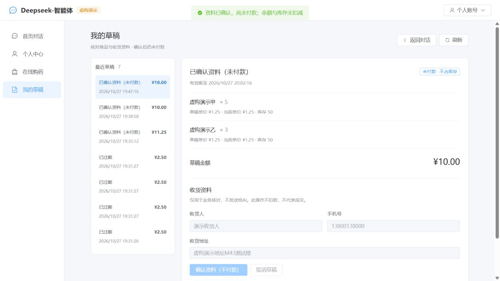
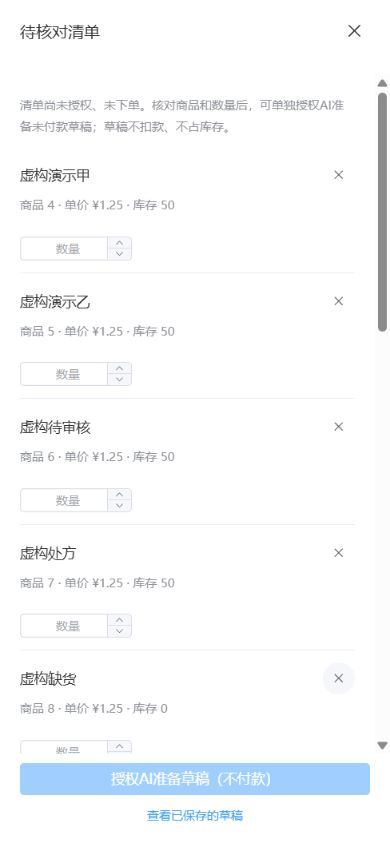

# M4.3 验收报告

完成日期：2026-10-27，Asia/Hong_Kong。状态：完成，审查问题已修复并复验。
Java继续负责传统业务、权限与事务；Python负责AI、工具编排和RAG。

## 结果

| 检查 | 最终结果 | 证据 |
| --- | --- | --- |
| Java业务回归 | 48项通过，0失败 | target/m43-test.log；Java打包成功 |
| Python协议与业务边界 | 83项通过，0失败 | python-ai/m43-test.log |
| 前端协议、清单、授权竞态 | 32项通过，0失败 | DeepseekDoc/m43-test.log |
| 运维与隔离保护 | 14项通过，0失败 | .local-demo/logs/m43-ops-test.log |
| 语法/构建 | compileall、Vite build、Maven package通过 | 各构建日志；仍有既有前端分包提示 |
| 真实服务回归 | 30组通过：8+6+6+10 | evidence/m43/*live-results.json |
| 登录态浏览器 | 22组通过 | evidence/m43/browser-results.json |
| 固定模型评测 | 6类×3次，共18次通过 | evidence/m43/m43-evaluation.json |
| 数据隔离 | 正常库7张表哈希不变 | evidence/m43/isolation-reset.json |
| 财务/隐私 | 演示余额、库存、成交订单不变，收货地址不进AI历史 | evidence/m43/financial-privacy.json |

合计177项自动化测试。实际服务、浏览器和模型用例为额外验收组，
不能把这些不同粒度的数字相加当作统一测试覆盖率。
最终源码、JAR和验收文件的SHA-256见evidence/m43/release-manifest.json。

实际链路为 Vue/Vite → Java/MySQL + FastAPI/SQLite → 本机Ollama；没有以模拟模型代替真实模型联调。
错误协议、超时、不确定写结果、延迟授权等则通过可控协议/Promise测试验证，
不冒称已在真实模型上逐一制造这些异常。

## 登录态与布局

主流程：合成账号登录，发送“帮我下单5件虚构演示甲，3件虚构演示乙”，
真实目录查询，结构化清单5/3，取消/重选，数值加到6再减回5，独立授权，
原生prepare_order_draft，进入Java私有核对页，再断言草稿5/3与总额10.00元，
填写合成收货资料并确认，最终为CONFIRMED且paid=false。

同时验证未审核商品可勾选但不能授权；历史保留数量而不自动选择；
未给数量保持空白；十项清单的抽屉独立滚动及底部按钮可达；
长输入、键盘上翻、回到最新、停止SSE、撤回授权、退出与账号切换。
另外从页面检查调价、缺货、审核版本变化、过期均不能确认，另一个账号无法读取草稿内容。

| 尺寸 | 消息区高度 | 输入区底边 | 页面宽度 | 结果 |
| --- | --- | --- | --- | --- |
| 1366×768 | 447px | 751.2px | 1366px | 无横向溢出，输入区在屏内 |
| 450×668 | 314px | 659.2px | 450px | 无横向溢出，消息区独立滚动 |
| 390×844 | 496px | 835.2px | 390px | 无横向溢出，抽屉底部可达 |

十项抽屉：内容1831px、可视区680px、footer底边844px；完整结构与截图已保存。
截图只含虚构商品、测试账号和合成收货资料。

## 固定评测

数据集 scripts/m43-cases.json，版本m43-v1；每条均创建独立会话，保留全部运行结果。
授权和草稿的10个固定业务检查另由scripts/m43-business-cases.json（m43-business-v1）定义，
映射到真实MySQL的M4.2执行器；不把它们混入18次只读模型评测。
模型deepseekdoc-qwen2.5-tools:latest，温度0；模型digest、工具模板、Agent、
模型客户端和知识manifest哈希见原始JSON。平台规则索引为独立构建的4文档、5父块、8子块、1024维。

| 指标 | 结果 |
| --- | --- |
| 真实原生目录调用 | 18/18 |
| 商品对应与数量准确（含应为空） | 各15/15；另外3次为规格澄清 |
| 未审核/RX/缺货正确阻断 | 9/9；不计入合法草稿成功率 |
| 多规格安全澄清 | 3/3，未自行拆分数量 |
| 原生propose_purchase | 9次 |
| 服务端精确匹配只读恢复 | 6次，单独标记runtime_grounded |
| 规格澄清、未生成proposal | 3次 |
| 总耗时中位数/范围 | 3.367秒 / 1.391–10.296秒 |

18/18是包含确定性边界和恢复策略的端到端结果，**不是18次模型都正确原生生成清单**。
实际草稿准备成功、同请求幂等恢复、确认/取消竞态等由独立Java/MySQL/浏览器场景验证，
只读评测的draftBusinessSuccess字段保持null。

首轮缩短商品名、跳过结构化清单等失败记录已保留在evaluation-before-review.json、
evaluation-diagnostic-before-fix.json、evaluation-after-grounding-before-clarification.json等历史文件，
没有删除失败样本后伪造成功率。最终小样本不代表生产、医疗或第三方支付可靠性。

## 隔离复现与审查

已实际执行：初始化、重复初始化、构建规则库、启动、业务回归；
随后记录正常库服务端哈希，reset演示库、重新初始化两次、重建索引、重启并再次回归。
正常库users、medicines、orders、order_items、order_drafts、order_draft_items、
profile_consent_events均未变化；正常数据原值未写入报告。
演示账号和临时测试账号分开，联调成功创建记录正常清理后无残留所有权清理文件。

审查修复包括完整商品名绑定、历史数量、清单恢复、规格澄清、只查询意图、
草稿列表同步、跨环境进程保护，以及迟到授权按原USER/请求键定向撤销。
延迟响应与账号切换的竞态在前端Promise测试复现；定向撤销的所有权、
新授权保留、无效请求键不扩大撤销范围由Java测试及真实MySQL验证。

复现命令、架构/状态图与演示脚本见[M4.3-operations.md](M4.3-operations.md)，
审查发现和剩余限制见[M4.3-review.md](M4.3-review.md)，
Java/Python约定见[java-python-contract.md](java-python-contract.md)。

正常站点保留3000端口，演示站点使用13000端口；AI没有确认/支付权限。
后续M5.1先冻结订单支付状态机及短期一次性支付授权，再实现独立钱包验证与事务支付。
