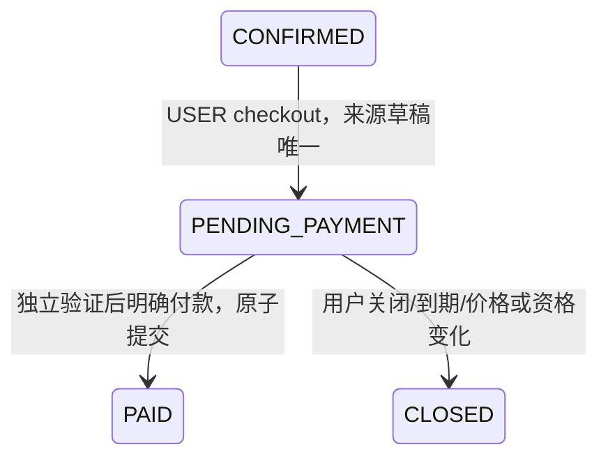

# M5.1-A 冻结设计

后续状态：M5.1-B已实现Java后端，见[M5.1-B-implementation.md](M5.1-B-implementation.md)。
本页以下保留A阶段冻结时的设计描述；原设计机器契约已归档至archive/m51-payment-design.openapi.json，活跃契约为5.1.0。

日期：2026-10-28。版本：5.1.0-design.1。状态：设计冻结，运行接口尚未实现。
范围：演示钱包，不接第三方收单，不增加Python支付工具，不执行真实库迁移。
机器契约：m51-payment.openapi.json；SQL提案：sql/M5.1-A.proposed.sql。
现行4.3契约继续有效，本文件是M5.1-B/C必须遵循的增量规范。

## 状态与快照

CONFIRMED是草稿状态，转换订单后仍保留CONFIRMED与原私有快照，不能再次转换。
orders.payment_status是支付状态，旧status只作兼容展示：新待支付映射pending、
PAID映射completed、CLOSED映射cancelled。PAID不等于已发货，不可删除或取消。
历史payment_status=NULL在新读模型显示LEGACY_UNVERIFIED，禁止进入新支付流程，
不能仅根据completed补写PAID；以后经流水核对的历史标记须保留审计证据。

checkout只接受本人CONFIRMED草稿，首次转换须now < 草稿原expires_at。
重新核对价格、数量、库存、销售资格及审核版本，复制商品名称、价格、数量、审核版本、
收货资料到订单快照。明确不从客户端或模型接受总价、用户ID、收货覆盖或支付状态。
同一草稿最多一个订单；同请求键重放先返回原订单，不因草稿/订单后来过期而再创建。
更换请求键再次checkout也返回同一个来源订单，不延长到期时间。

订单从创建起有效900秒，授权有效min(now+60,父USER会话期限,订单到期时间)。
以Java服务端UTC epoch秒为准，now >= expiresAt即失效。待支付不预占库存。
读取/验证/支付/关闭均检查期限，必要时事务持久化CLOSED；不能依赖定时任务或前端倒计时。
订单版本初始1，PAID/CLOSED变更各加1；重复终态操作不再加版本。
商品/金额/收货快照不可修改，重新选择须新草稿；旧订单不自动改价。

金额为CNY两位十进制定点字符串，范围0.01–99999999.99；内部BigDecimal/DECIMAL(10,2)。
单行数量严格整数1–99、1–10种且ID不重复；合计溢出必须在创建前拒绝，不截断或四舍五入。
积分沿用现有floor(实付元)规则，只发放一次，超过Java int范围拒绝交易。

## 身份与权限冻结

| 能力 | USER | AGENT_READ | AGENT_ORDER_PREPARE | Python/模型 |
| --- | --- | --- | --- | --- |
| checkout、订单私有详情、关闭 | 仅本人 | 禁止 | 禁止 | 禁止 |
| 验证支付密码、签发/撤销支付授权、付款 | 仅本人 | 禁止 | 禁止 | 禁止 |
| 原内部订单摘要 | 通过原用户入口 | 服务密钥＋本人摘要 | 禁止 | 仅原只读工具 |
| 原未付款草稿准备 | 原独立授权流程 | 不能写 | 精确商品数量绑定 | 保持M4规则 |

支付授权是业务能力，不是新增Bearer角色。Authorization始终是USER；
X-Payment-Authorization独立承载支付token，不能用登录/读取/准备授权替代。
token为32随机字节base64url（43字符），数据库只存SHA-256哈希。
绑定原USER会话哈希、用户、订单、订单版本、快照金额、币种及到期时间。
父会话失效即不可使用；重新签发同订单授权先撤销旧授权。
签发不接受自动重试，不存可恢复明文token。响应丢失时用户先撤销旧授权，再明确重新验证。
撤销支持authorizationId定向清理迟到响应，外用户ID返回统一成功，不泄露存在性。
浏览器签发和清理均绑定发起时USER凭证；离页、切号、退出或撤回后不得消费迟到响应。

密码只进入独立验证请求，不进模型、URL、日志、数据库明文或localStorage。
沿用现有BCrypt校验、UTF-8最多72字节、5次失败锁900秒；JSON必须是字符串，不trim密码。
复用CredentialVerifier独立提交失败计数的机制，不能把它嵌入已持有用户行锁的外事务，
以免REQUIRES_NEW等待外事务或失败计数随结算回滚。
流程：认证和初检→独立验证→事务内重验会话/订单/期限/版本→撤销旧授权并签发。
通过密码验证不保证随后能签发，不能提前承诺扣款。

## 幂等、锁与事务

checkout、pay强制Idempotency-Key：8–64位[A-Za-z0-9_-]，按用户＋操作＋键隔离。
请求指纹绑定路径订单/草稿ID与原expectedVersion；不包含密码或明文支付token。
同键不同请求409 IDEMPOTENCY_CONFLICT。不得因换键绕过来源草稿唯一或订单支付唯一。
认证及目标所有权确认后，先在无外层业务锁的短事务登记REGISTERED请求指纹，
再开启业务事务；登记冲突先比较指纹。成功结果在业务事务中标SUCCEEDED，
确定拒绝在决策事务中标REJECTED并保存错误码，重放该请求返回相同拒绝。
已确认回滚的临时故障保留REGISTERED，允许用户显式同键同体重试。
进程崩溃遗留REGISTERED不能直接判失败：GET用paymentRequestKey恢复该请求状态，
在订单锁/唯一来源约束下解析实际订单，再决定是否允许原请求继续，不生成新键。
pay要求独立授权头存在；USER所有权确认后，先查已提交幂等结果/PAID终态，
再检查授权是否已消费、版本是否已变。这样成功重放可返回原付款凭据。
不同键遇已PAID也返回原收据且不消费新授权；缺失原授权头时通过GET恢复，不重新扣款。
关闭已CLOSED返回现有状态，关闭PAID返回409 ORDER_ALREADY_PAID。

所有写路径统一锁序：用户→草稿（涉及转换时）→订单→该订单授权→商品ID升序。
涉及幂等登记时，请求记录锁置于用户之后、草稿/订单之前；独立登记事务结束后才进入业务事务。
原M4草稿/会话/撤销锁序需保持用户在前；多用户争商品不得反向获取其他用户锁。
支付在同一事务内重验身份、授权、状态、期限、资格、版本、价格、库存及余额，
并原子提交：余额/库存扣减、积分、订单PAID、支付记录、唯一流水、幂等记录、授权CONSUMED。
payment_records.order_id、ledger_id各唯一；失败不能留下任何部分财务变更。
财务记录不外键依赖可删除的登录或授权行，退出不删除已付款审计链。

确定业务拒绝：在无资金变更的决策事务中提交授权REVOKED，以及必要的订单关闭，
**提交后**再映射HTTP错误，不能用抛出运行时异常把撤销一并回滚。
发生资金写入中途故障：全量回滚；不能在不确认提交结果时宣称未扣款。
可证明回滚才返回TRANSACTION_RETRYABLE/NOT_APPLIED；无法确认提交结果返回UNKNOWN，
客户端只查本人订单/原请求结果，不自动换键、换授权或再次付款。

## 异常与恢复矩阵

| 场景 | HTTP/代码 | 状态与恢复 |
| --- | --- | --- |
| 非法JSON、金额/数量/版本/键 | 400 INVALID_REQUEST | 不执行资金写入 |
| USER会话失效 | 401 UNAUTHORIZED | 不签发/付款；要求重新登录 |
| 支付密码失败 | 401 PAYMENT_VERIFICATION_FAILED | 失败计数独立提交，不清除其他账号登录 |
| 验证锁定 | 429 RATE_LIMITED | Retry-After秒；不触发隐式验证重试 |
| 代理角色访问USER接口 | 403 FORBIDDEN | 禁止付款与签发 |
| 非本人/不存在订单或草稿 | 404 ORDER_NOT_FOUND/DRAFT_NOT_FOUND | 不返回他人快照或状态 |
| 历史未核验订单 | 409 LEGACY_ORDER_UNVERIFIED | 不接入新付款 |
| 重复键不同请求 | 409 IDEMPOTENCY_CONFLICT | 保留原结果，不创建新记录 |
| 版本冲突 | 409 ORDER_VERSION_CONFLICT | 撤销该订单旧授权，重新核对 |
| 价格/资格/审核版本变化 | 409 PRICE_CHANGED/SALE_NOT_ALLOWED/QUALIFICATION_CHANGED | CLOSED/CATALOG_CHANGED，撤销该订单全部授权，新草稿 |
| 缺货 | 409 OUT_OF_STOCK | 仍待支付，撤销该订单全部授权；补货后需重新验证 |
| 余额不足 | 422 INSUFFICIENT_BALANCE | 仍待支付，撤销该订单全部授权；充值后需重新验证 |
| 积分将溢出 | 422 POINTS_LIMIT | 仍待支付，撤销该订单全部授权，无资金或积分变更 |
| 授权缺失/过期/撤销/绑定不符 | 401 PAYMENT_AUTHORIZATION_INVALID | 不清除有效USER登录，不自动签发 |
| 订单到期 | 409 ORDER_EXPIRED | CLOSED/EXPIRED，撤销授权，无资金变更 |
| 订单已关闭 | 409 ORDER_CLOSED | 不得付款 |
| 付款和关闭竞争 | PAID或CLOSED | 在订单锁下只有一个结果；不会既扣款又关闭 |
| 确认回滚的数据库故障 | 503 TRANSACTION_RETRYABLE | outcome=NOT_APPLIED；用户可显式同键重试 |
| 网络断开/提交结果不确定 | 503 PAYMENT_OUTCOME_UNKNOWN或无响应 | outcome=UNKNOWN；仅GET恢复 |

错误体code/message，mutation错误另给outcome=NOT_APPLIED或UNKNOWN；
UNKNOWN不得展示“未扣款”。所有支付/私有响应Cache-Control:no-store；拒绝重定向传递凭证。
日志仅记录服务端追踪ID、业务ID、错误码、耗时，不记录密码、授权头、收货或健康档案。

## 兼容切换与迁移发布

旧GET /api/orders/{orderId}需在B中适配新读模型，保持已有字段并增量提供支付信息；
旧列表同样区分LEGACY_UNVERIFIED。模型内部摘要只增加可信支付状态，不复制私有字段。
v5金额统一为定点字符串，属于需同步前端适配的契约变化，不声称旧数值类型客户端可零修改升级。
旧POST /api/orders在M5开关启用时返回409 LEGACY_CHECKOUT_DISABLED，指引统一checkout/pay；
Form.vue同步迁移，不能留出“旧接口带密码直接成交”的旁路。
订单DELETE现已ORDER_DELETE_DISABLED，继续保留；退款和隐藏展示不在本期实现。
上线开关必须同时覆盖新API、旧写接口与前端入口，不能只开放其中一部分。

SQL提案在docs/sql而非自动迁移目录。B阶段先备份/验证可恢复性，检查M1–M4表结构、
重复关联、外键字符集排序规则和金额异常，再在隔离MySQL执行DDL与兼容回归。
MySQL DDL不保证随业务ROLLBACK撤销；须逐条记录完成状态，部分失败用information_schema核对，
不能盲目重复ALTER或DROP。无自动历史资金回填，无DELETE/UPDATE真实业务记录。
回退优先关闭M5入口并保留新增表列，让旧应用忽略它们；已产生PAID后禁止切回旧直接结算路径。
恢复备份只在停写并核对所有备份后的交易后进行，不能覆盖新付款审计链。

## A阶段验收与B阶段门槛

A交付：本设计、独立标记未实现的OpenAPI、非自动执行的增量SQL提案、固定验收向量、
契约静态检查与审查记录。A不声称MySQL迁移或付款已运行通过。
B必须补充：隔离MySQL执行/重入/恢复演练、DAO映射/严格DTO、安全路由、真实并发与故障注入。
重点验证最后库存竞争、同键/换键重放、支付/关闭并发、一次性授权消费、
失败计数不回滚、全部资金副作用原子性，以及代理越权和迟到授权定向撤销。
